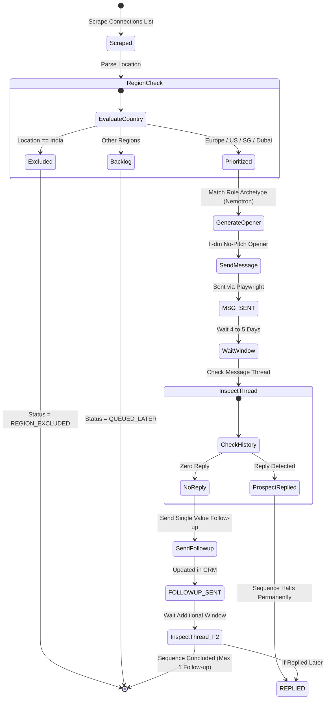
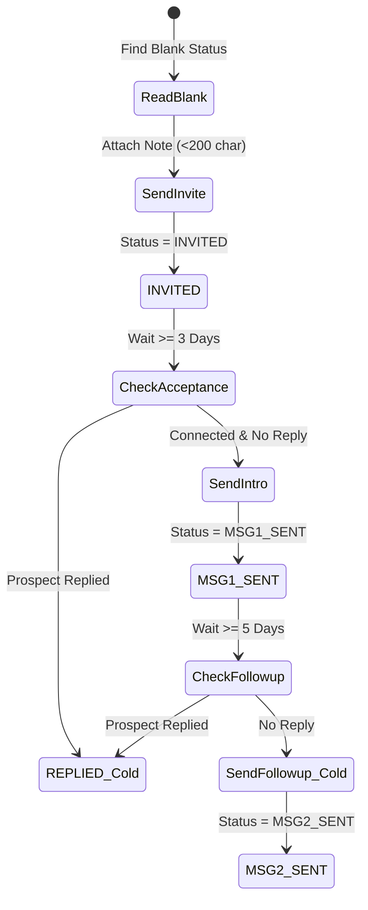
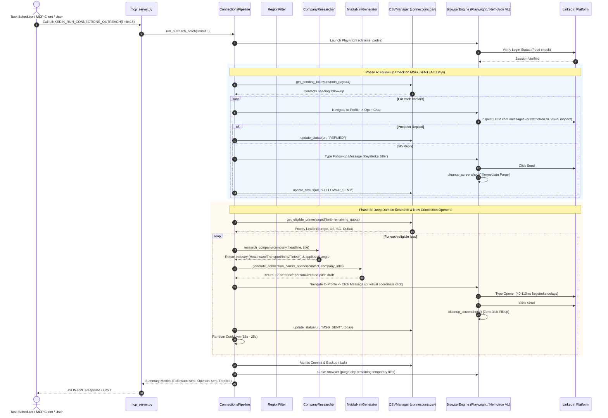

# System Architecture & Technical Design Document (TDD)
## Autonomous LinkedIn Outreach & Multi-Agent Intelligence Engine

**Project:** `linkedin_outreach`  
**System Version:** 2.1.0  
**Architecture Classification:** Dual-Pipeline Hybrid (Browser Stealth Engine + Custom Stdio MCP Server)  
**Target Platform:** Windows 10/11 x64 (Cross-compatible with macOS / Linux)  
**Repository Path:** `c:\New folder (2)\linkedin_outreach`

---

## 1. System Overview & Architectural Objectives

The **Autonomous LinkedIn Outreach Engine** is engineered as a decoupled, fault-tolerant system designed to execute daily cold outreach, re-engage existing 1st-degree network connections for career opportunities, track prospect states, generate humanized non-pitch copy, and expose standard Model Context Protocol (MCP) tools to any AI assistant or orchestrator.

### Core Architectural Pillars
1. **Single Stealth Browser Session**: Playwright operates directly on an authenticated Google Chrome user data profile (`chrome_profile/`). LinkedIn sees genuine human browser interactions rather than API bot calls, maintaining high session trust.
2. **Custom Stdio MCP Server (`mcp_server.py`)**: Exposes programmatic browser tools (`LINKEDIN_GET_CONNECTIONS`, `LINKEDIN_SEND_CONNECTION_MESSAGE`, `LINKEDIN_RUN_CONNECTIONS_OUTREACH`) via standard JSON-RPC 2.0 over standard I/O (stdio). Any MCP-compliant client (Claude Desktop, Antigravity, Cursor, or local agents) can query and drive the pipeline natively.
3. **Dual Operational Pipelines**:
   - **Cold Outreach Pipeline**: Dispatches targeted connection invites (<200 characters) and multi-step intro/follow-up sequences to new leads.
   - **Existing-Connections Extension**: Scrapes 1st-degree connections, applies regional filters (excluding India; prioritizing Europe/UK/Ireland, US, Canada, Singapore, Dubai), generates role-archetype openers via NVIDIA NIM, and sends low-pressure DMs with 4–5 day follow-up logic.
4. **Decoupled Standalone Runtime**: Operates using a self-contained CPython distribution (`runtime/`) with native binaries, eliminating virtual environment trampoline issues and Windows permission constraints.
5. **Zero-Database Atomic Persistence**: Uses localized CSV storage (`contacts.csv`, `connections.csv`) with automatic `.bak` backups before every mutation.

---

## 2. High-Level System Architecture

```mermaid
graph TD
    subgraph Triggers ["Scheduling & Execution Interfaces"]
        WTS["Windows Task Scheduler<br/>(LinkedInOutreachDaily @ 9:00 AM)"]
        CRON["Cron Daemon<br/>(Linux / macOS @ 9:00 AM)"]
        CLI_TRIG["CLI Terminal Commands<br/>(python -m linkedin_outreach.cli)"]
        UI_TRIG["FastAPI Dashboard / Webhook<br/>(http://127.0.0.1:8500)"]
    end

    subgraph MCPClientLayer ["MCP Clients & AI Assistants"]
        MCP_CLIENT["MCP Host Application<br/>(Claude Desktop / Antigravity / Agent CLI)"]
    end

    subgraph CustomMCP ["Custom Model Context Protocol (MCP) Server"]
        MCP_SERVER["LinkedIn Custom MCP Server<br/>(linkedin_outreach.mcp_server / stdio)"]
        TOOL_GET_CONN["LINKEDIN_GET_CONNECTIONS"]
        TOOL_FILTER["LINKEDIN_FILTER_CONNECTIONS"]
        TOOL_GEN_MSG["LINKEDIN_GENERATE_CONNECTION_MSG"]
        TOOL_SEND_MSG["LINKEDIN_SEND_CONNECTION_MESSAGE"]
        TOOL_STATUS["LINKEDIN_GET_PIPELINE_STATUS"]
    end

    subgraph CoreEngine ["Outreach Core Engine"]
        COLD_PIPE["Cold Outreach Pipeline<br/>(pipeline.py)"]
        CONN_PIPE["Connections Outreach Pipeline<br/>(connections_pipeline.py)"]
        REGION_FILTER["Region & Location Filter<br/>(region_filter.py)"]
        COMPANY_RES["Company Domain Researcher<br/>(company_researcher.py)"]
        COLD_ACTIONS["Cold Invite DOM Actions<br/>(linkedin_actions.py)"]
        CONN_ACTIONS["Connection DOM Actions<br/>(connections_actions.py)"]
        TEMPLATES["Template & Variable Engine<br/>(templates_engine.py)"]
        AI_NIM["NVIDIA NIM Personalizer<br/>(ai_generator.py - Nemotron 3 Super)"]
    end

    subgraph BrowserLayer ["Stealth Browser & Multimodal Control Layer"]
        BROWSER_ENG["Playwright Browser Controller<br/>(browser_engine.py)"]
        NIM_VL["NVIDIA Nemotron 3.5 Super VL<br/>(Visual Inspection & Coordinate Clicking)"]
        CHROME_PROFILE["Persistent Chrome Profile<br/>(./chrome_profile/)"]
        CDP_ATTACH["Chrome DevTools Protocol (CDP)<br/>(Ports 18800 / 9222)"]
        LINKEDIN_WEB["LinkedIn Web Application<br/>(https://www.linkedin.com)"]
    end

    subgraph StorageLayer ["Atomic Storage & Storage Hygiene Layer"]
        CSV_MGR["CSV CRM Manager<br/>(csv_manager.py)"]
        COLD_CSV["contacts.csv<br/>(Cold Leads Database)"]
        CONN_CSV["connections.csv<br/>(1st-Degree Network Database)"]
        COMPANY_CACHE["company_cache.json<br/>(Domain & Product Cache)"]
        RAM_SCREEN["Ephemeral In-Memory Screenshots<br/>(Zero Disk Footprint / Post-Send Purge)"]
        BACKUPS["Rolling Backups (.bak)<br/>(./data/backups/)"]
        LOGS["Execution Logs<br/>(./logs/outreach.log)"]
    end

    %% Trigger Connections
    WTS --> COLD_PIPE
    WTS --> CONN_PIPE
    CRON --> COLD_PIPE
    CLI_TRIG --> COLD_PIPE
    CLI_TRIG --> CONN_PIPE
    UI_TRIG --> COLD_PIPE
    UI_TRIG --> CONN_PIPE

    %% MCP Connections
    MCP_CLIENT <--> |stdio JSON-RPC| MCP_SERVER
    MCP_SERVER --> TOOL_GET_CONN
    MCP_SERVER --> TOOL_FILTER
    MCP_SERVER --> TOOL_GEN_MSG
    MCP_SERVER --> TOOL_SEND_MSG
    MCP_SERVER --> TOOL_STATUS

    TOOL_GET_CONN --> CONN_PIPE
    TOOL_FILTER --> REGION_FILTER
    TOOL_GEN_MSG --> AI_NIM
    TOOL_SEND_MSG --> CONN_ACTIONS
    TOOL_STATUS --> CSV_MGR

    %% Pipeline Wiring
    COLD_PIPE --> COLD_ACTIONS
    COLD_PIPE --> TEMPLATES
    COLD_PIPE --> CSV_MGR
    COLD_PIPE --> BROWSER_ENG

    CONN_PIPE --> REGION_FILTER
    CONN_PIPE --> COMPANY_RES
    COMPANY_RES --> COMPANY_CACHE
    CONN_PIPE --> AI_NIM
    CONN_PIPE --> CONN_ACTIONS
    CONN_PIPE --> CSV_MGR
    CONN_PIPE --> BROWSER_ENG

    COLD_ACTIONS --> BROWSER_ENG
    CONN_ACTIONS --> BROWSER_ENG
    BROWSER_ENG <--> NIM_VL
    BROWSER_ENG --> RAM_SCREEN
    BROWSER_ENG --> CHROME_PROFILE
    BROWSER_ENG --> CDP_ATTACH
    BROWSER_ENG --> LINKEDIN_WEB

    %% Storage Wiring
    CSV_MGR --> COLD_CSV
    CSV_MGR --> CONN_CSV
    CSV_MGR --> BACKUPS
    COLD_PIPE --> LOGS
    CONN_PIPE --> LOGS
```



---

## 3. Subsystem Breakdown & Component Architecture

### 3.1 Custom Stdio MCP Server (`mcp_server.py`)
- **Role**: Provides standard Model Context Protocol (MCP) compliance over stdio JSON-RPC 2.0.
- **Protocol Support**: Tools list (`tools/list`), Tool execution (`tools/call`), and Initialization handshake (`initialize`).
- **Features**:
  - Requires zero third-party dependencies; uses a robust internal JSON-RPC 2.0 protocol handler.
  - Automatically bridges LLM tool calls directly to `BrowserEngine`, `RegionFilter`, `NvidiaNimGenerator`, and `CSVManager`.
  - Can be registered in any MCP configuration file (e.g. `claude_desktop_config.json`, Antigravity `mcp_config.json`, or standalone runners):
    ```json
    {
      "mcpServers": {
        "linkedin-connections": {
          "command": "c:\\New folder (2)\\linkedin_outreach\\.venv\\Scripts\\python.exe",
          "args": ["-m", "linkedin_outreach.mcp_server"],
          "cwd": "c:\\New folder (2)\\linkedin_outreach"
        }
      }
    }
    ```

### 3.2 Existing-Connections Outreach Engine (`connections_pipeline.py`)
- **Role**: Orchestrates 1st-degree connection retrieval, regional filtering, company domain intelligence, role-based message generation, and dispatch.
- **Workflow**:
  1. Calls `connections_actions.py` to retrieve the latest connection cards from `https://www.linkedin.com/mynetwork/invite-connect/connections/`.
  2. Applies `RegionFilter` to exclude India-based profiles and rank priority regions (UK/EU, US/Canada, Singapore, Dubai).
  3. Executes `CompanyResearcher` to identify the organization's exact industry sector (Healthcare, Transport, Infra, Fintech) and determine Shaurya's applied AI angle.
  4. Detects Role Archetypes (Engineering Leadership, Senior IC, Product, Recruiter).
  5. Calls `NvidiaNimGenerator` to draft personalized, no-pitch openers following `li-dm` rules.
  6. Sends openers via `connections_actions.py` with human typing cadence and marks status as `MSG_SENT`.
  7. Triggers immediate post-send screenshot cleanup (`cleanup_screenshots()`) to ensure zero disk pileup.
  8. Tracks elapsed time for previous messages: if 4–5 days have passed with zero response, inspects the thread and dispatches a single follow-up (`FOLLOWUP_SENT`).
  9. If a reply is detected, immediately flags status as `REPLIED` and halts automation.

### 3.3 Regional & Location Filter (`region_filter.py`)
- **Role**: Deterministic geolocation parser and filtering engine.
- **Filtering Logic**:
  - **Exclusion List**: Explicitly matches India, Indian states (e.g., Karnataka, Maharashtra, Delhi, Tamil Nadu), and metro areas (Bengaluru, Mumbai, Hyderabad, Pune, Gurugram, Noida).
  - **Priority Inclusions**:
    - `Tier 1`: United Kingdom (London, Manchester, Edinburgh, etc.), Ireland (Dublin), Germany, Netherlands, France, Switzerland, Sweden, Norway, Denmark.
    - `Tier 2`: United States (SF Bay Area, NYC, Seattle, Austin, etc.) and Canada (Toronto, Vancouver, Montreal).
    - `Tier 3`: Singapore.
    - `Tier 4`: Middle East (Dubai, Abu Dhabi, UAE, Riyadh, Doha).
  - **Backlog Handling**: Non-matching contacts are retained with status `REGION_EXCLUDED`, ensuring no data loss.

### 3.4 Deep Company Domain Intelligence Engine (`company_researcher.py`)
- **Role**: Automatically researches what each target connection's company actually does before any message is drafted.
- **Model**: `nvidia/nemotron-3-super-120b-a12b` via NVIDIA NIM.
- **Domain Mapping & Applied AI Translation**:
  - **Healthcare / Medical**: Maps to clinical data intelligence, patient care workflows, and medical agent tooling.
  - **Transportation / Mobility**: Maps to route optimization, fleet dispatch automation, and mobility intelligence.
  - **Cloud Infrastructure / DevOps**: Maps to cloud observability, telemetry agents, and low-latency LLM orchestration.
  - **Fintech / Banking**: Maps to transaction anomaly detection, automated audit reporting, and conversational banking agents.
- **Persistence**: Results are stored in `./data/company_cache.json` for persistent fast lookup and zero API redundancy.

### 3.5 AI Role Archetype Personalizer (`ai_generator.py`)
- **Role**: Generates non-pitch career outreach openers tailored to both professional seniority and company mission.
- **Model**: `nvidia/nemotron-3-super-120b-a12b` via NVIDIA NIM (1024 token buffer).
- **Archetype Profiles**:
  - **Engineering Leadership (VP, CTO, Head of AI, Director)**: Focuses on architectural insights, agentic reliability challenges, and exploring engineering internship/relocation opportunities.
  - **Senior Technical IC (Staff/Principal Engineer, Tech Lead)**: Focuses on technical peer dialogue, open-source/model development, and team opportunities.
  - **Product Leadership (VP Product, Product Lead)**: Focuses on applied AI product workflows and product engineering alignment.
  - **Talent & Recruitment (Recruiter, Head of Talent)**: Focuses on direct inquiries regarding AI engineering openings and remote/relocation policies.

### 3.6 Multimodal Visual Browser Controller & Storage Hygiene (`browser_engine.py`)
- **Role**: Playwright stealth browser controller enhanced with multimodal vision capabilities and strict ephemeral storage hygiene.
- **Vision Model**: `nvidia/nemotron-3.5-super-vl-120b-a12b` via NVIDIA NIM.
- **Visual Capabilities**:
  - `visual_browser_inspect`: Takes an in-memory base64 screenshot to inspect page state, modal popups, 2FA prompts, or weekly limit dialogs.
  - `visual_locate_element` / `visual_locate_and_click`: Determines exact `(x, y)` pixel coordinates of target buttons (*Message*, *Send*, *Dismiss*) when DOM selectors are obfuscated or hidden inside shadow DOM.
- **Zero-Storage Ephemeral Screenshot Architecture**:
  - Screenshots are captured strictly into memory as PNG byte streams (`page.screenshot(type="png")`) and converted to base64. Zero bytes are written to disk.
  - `cleanup_screenshots()` executes automatically in a `finally` block after every message dispatch and upon browser shutdown, guaranteeing that drive storage never piles up.
- **Session Persistence**: Directly attaches to `./chrome_profile/` so LinkedIn session cookies and 2FA tokens remain active indefinitely.
- **CDP Port Probing**: Automatically probes ports `18800` and `9222` to attach to existing active Chrome instances before launching a new browser process.
- **Anti-Detection**: Launches with `--disable-blink-features=AutomationControlled` to suppress `navigator.webdriver`.

### 3.7 Cold Outreach Engine (`pipeline.py` & `linkedin_actions.py`)
- **Role**: Manages top-of-funnel cold invites (<200-char notes), Step 2 intro DMs, and Step 3 follow-ups with daily limits (20 invites/day, 20 messages/day).
- **Role**: Manages top-of-funnel cold invites (<200-char notes), Step 2 intro DMs, and Step 3 follow-ups with daily limits (20 invites/day, 20 messages/day).

---

## 4. State Machines & Lifecycle Flows

### 4.1 Existing-Connections Outreach State Machine



### 4.2 Cold Outreach State Machine (Existing)



---

## 5. End-to-End Sequence Diagram: Connections Outreach



---

## 6. Data Models & Schemas

### 6.1 Connections CSV Schema (`connections.csv`)

| Column Name | Data Type | Description | Example |
|---|---|---|---|
| `Full Name` | String | Full name of the connection | `Sarah Jenkins` |
| `First Name` | String | Extracted first name for templates | `Sarah` |
| `Last Name` | String | Extracted surname | `Jenkins` |
| `Title` | String | Clean professional title | `VP of Engineering` |
| `Company` | String | Employer organization | `Syntropy AI` |
| `Headline` | String | Full LinkedIn headline | `VP of Eng @ Syntropy \| Scaling Agent Infra` |
| `Location` | String | Resolved geographical location | `London, England, United Kingdom` |
| `Region Tier` | String | Priority classification | `Tier 1 (Europe)` |
| `LinkedIn URL` | String | Canonical LinkedIn profile URL | `https://www.linkedin.com/in/sarah-jenkins` |
| `Status` | Enum | `RETRIEVED` \| `MSG_SENT` \| `FOLLOWUP_SENT` \| `REPLIED` \| `REGION_EXCLUDED` \| `QUEUED_LATER` | Current pipeline stage |
| `Sent Date` | Date | Date initial message was dispatched | `2026-10-20` |
| `Followup Date`| Date | Date follow-up was dispatched | `2026-10-25` |
| `Notes` | String | Archetype, feedback, or response notes | `Archetype: Eng Leadership` |

---

## 7. Sandboxing, Runtime & Permission Architecture

To ensure flawless execution across any environment:

1. **Self-Contained Standalone Runtime (`linkedin_outreach\runtime\`)**:
   - Contains a standalone CPython 3.14 distribution with genuine 241 KB executables.
   - Eliminates the `uv trampoline (os error 5: Access is denied)` failure on Windows.
2. **Universal Path Resolution (`linkedin_outreach.pth`)**:
   - Injected into `Lib/site-packages` so `python -m linkedin_outreach.cli` or `mcp_server` works regardless of current working directory.
3. **Discretionary Access Control (ACLs)**:
   - Configured with `icacls "c:\New folder (2)\linkedin_outreach" /grant "Users:(OI)(CI)RX" /T` to prevent process isolation denials.

---

## 8. Operational Commands & Integration Guide

### 8.1 Registering the Custom MCP Server
Add the following snippet to your preferred MCP client configuration:
```json
{
  "mcpServers": {
    "linkedin-engine": {
      "command": "c:\\New folder (2)\\linkedin_outreach\\.venv\\Scripts\\python.exe",
      "args": ["-m", "linkedin_outreach.mcp_server"],
      "cwd": "c:\\New folder (2)\\linkedin_outreach"
    }
  }
}
```

### 8.2 Command Line Cheat-Sheet

| Action | Command |
|---|---|
| **Run MCP Server Directly** | `.venv\Scripts\python.exe -m linkedin_outreach.mcp_server` |
| **Check Cold Pipeline Status** | `.venv\Scripts\python.exe -m linkedin_outreach.cli status` |
| **Scrape 1st-Degree Connections**| `.venv\Scripts\python.exe -m linkedin_outreach.cli connections scrape --limit 50` |
| **Run Connections Outreach Batch**| `.venv\Scripts\python.exe -m linkedin_outreach.cli connections run --limit 15` |
| **Launch Web Control Center** | `.venv\Scripts\python.exe -m linkedin_outreach.cli serve --port 8500` |
| **Trigger Daily Scheduled Batch** | `cmd.exe /c "c:\New folder (2)\linkedin_outreach\run_outreach.bat"` |
